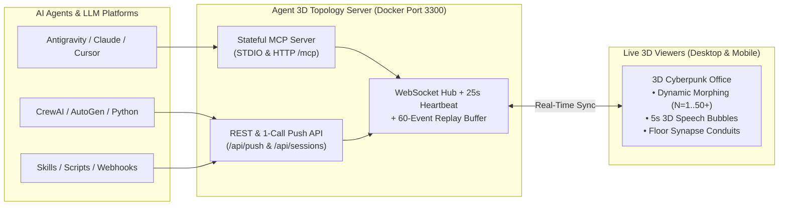

# 🌐 Agent 3D Topology Hub (v4.0)

**Real-Time 3D Isometric Cyberpunk Multi-Agent Visualization Server, WebSocket Hub & Model Context Protocol (MCP) Server**

[](LICENSE)
[](Dockerfile)
[](src/mcp/index.js)
[](public/AgentOffice3D.js)

> 🌍 **Language / Ngôn ngữ:** [**🇺🇸 English Guide**](#-english-documentation--user-guide) | [**🇻🇳 Hướng Dẫn Tiếng Việt**](#-tài-liệu--hướng-dẫn-sử-dụng-tiếng-việt)

---

# 🇺🇸 English Documentation & User Guide

## 1. Overview

**Agent 3D Topology Hub** transforms any multi-agent system, swarm workflow, or background task into a live, interactive **3D Isometric Cyberpunk Command Center**.

Designed to run 24/7 as an ultra-lightweight Docker container (<50MB RAM) on a **Mac mini (Apple Silicon ARM64)**, Linux VPS, or local machine, it provides:
- **Multi-Session Isolation & Dual-Token Security:** Every agent team session generates a secret **Write Token (`sk_...`)** for agents to push updates and a **Read Token (`vt_...`)** for viewers to watch live on desktop, mobile, or tablet.
- **Universal Compatibility:** Built-in **Model Context Protocol (MCP)** server (both `STDIO` and `HTTP /mcp`) plus a **1-Call JSON Push Webhook (`POST /api/push`)** that works with Antigravity, Claude Desktop, Claude Code, Cursor, Windsurf, Cline, Roo Code, CrewAI, AutoGen, LangGraph, and n8n.
- **Zero External 3D Dependencies:** Powered by a pure HTML5 Canvas 2D isometric projection engine (`AgentOffice3D.js`) with Retina HiDPI rendering, mobile pinch-to-zoom touch gestures, and 60fps animations.



---

## 2. Key Features (v4.0)

* **🔄 Dynamic Topology Morphing ($N = 1 \to 50+$):**
  When agents dynamically spawn or leave within the same session, workstations smoothly glide across the neon floor (60fps lerp) and automatically morph between **4 spatial formations**:
  * **$N = 1$ (Solo Center):** Single central command desk.
  * **$N = 2 \dots 4$ (Semi-Circle Arc):** Curved arc facing the camera.
  * **$N = 5 \dots 12$ (Radial Command Hub):** Orchestrator/Leader at the 3-screen central command deck; worker agents arranged in an elliptical ring.
  * **$N > 12$ (Swarm Pod Matrix):** Scalable 2-column workstation matrix with a central walkway and **Elastic Auto-Framing Camera Zoom**.
* **🎮 Cyber Sofa Gaming Lounge & Physical 100% Data Handover Walk:**
  * **Idle / Standby Gaming:** When agents are idle (`progress: 0` or status `Idle / Rảnh / Standby`), they physically walk over to the **Cyber Sofa Gaming Lounge** to sit down, hold glowing gamepads, and play retro-cyber arcade games on the holographic big screen! As soon as a task arrives, they jump off the sofa and **run back to their workstation desks** to start typing.
  * **100% Milestone Handover Walk:** When an agent completes a task (`100%`), they stand up from their desk carrying a glowing **3D Data Cube (`📦 100%`)**, walk across the office floor to the **Leader/Orchestrator's desk** (or `reportTo` agent) to hand over the result with an energy burst, and then head to the Sofa Lounge to relax!
* **⚡ Glowing Floor Conduits & Data Packets:**
  Isometric circuit lines connect the Leader desk to every Subagent desk. Whenever an agent speaks or updates progress, glowing data pulses travel along the floor conduits in real time.
* **💬 5-Second 3D Speech Bubbles & Live Activity Feed:**
  Floating speech bubbles with countdown bars pop up over speaking agents, while a collapsible **Live Activity Feed Drawer** records the last 60 events and replays recent speech bubbles for late joiners.
* **📱 Retina HiDPI & Multi-Touch Ready:**
  Sharp rendering on 4K/Retina screens (`devicePixelRatio`), 1-finger drag to rotate, 2-finger pinch to zoom, tap to inspect any agent, and 1-click **🇻🇳 VI / 🇺🇸 EN** language switching.

---

## 3. Quick Start

### Option A: Run with Docker Compose (Recommended for Mac mini / VPS)

```bash
git clone https://github.com/tranlammankg/agent-3d-topology.git
cd agent-3d-topology

# 1. Build and start the 3D Server in background (Default port: 3300)
npm run docker:up

# 2. Install the bundled AI Skill (into ~/.gemini/config/skills & ~/.claude/skills)
npm run install-skill
```

Open **`http://localhost:3300`** in your browser and click **"🚀 Run Live Swarm Morphing Demo"** to watch a live team dynamically scale from $1 \to 4 \to 8 \to 14 \to 6$ agents!

#### 🌐 Expose Publicly via Cloudflare Tunnel (Zero Port-Forwarding)
1. Create a free tunnel in the [Cloudflare Zero Trust Dashboard](https://one.dash.cloudflare.com/) pointing to `http://agent-3d-server:3300`.
2. Copy `.env.example` to `.env` and set your `TUNNEL_TOKEN`:
   ```bash
   cp .env.example .env
   # Edit .env and paste TUNNEL_TOKEN=eyJh...
   docker compose --profile tunnel up -d
   ```

### Option B: Run Directly with Node.js (v18+)

```bash
npm install
npm start
# Trigger a live swarm morphing simulation from CLI:
npm run demo
```

---

## 4. MCP Server Integration (Claude, Cursor, Antigravity, Cline)

Add the following to your `mcp_config.json` or `claude_desktop_config.json`:

```json
{
  "mcpServers": {
    "agent-3d-topology": {
      "command": "node",
      "args": ["/absolute/path/to/agent-3d-topology/src/mcp/index.js"],
      "env": {
        "AGENT_3D_URL": "http://localhost:3300"
      }
    }
  }
}
```
*(If your server is hosted remotely or via Cloudflare Tunnel, set `AGENT_3D_URL` to `https://your-domain.com`. You can also connect directly to the Streamable HTTP MCP endpoint at `https://your-domain.com/mcp`).*

### Available MCP Tools (with Stateful Auto-Session Context)
The MCP server automatically remembers the active `sessionId` and `authToken`, so the LLM does not need to repeat tokens on every call:

| Tool Name | Description |
| :--- | :--- |
| `init_3d_session` | Creates a new 3D office session and returns the `viewUrl` (with `viewToken`) for the user to open. |
| `upsert_agents` | Adds or updates a batch of agents (`id`, `name`, `role`, `progress`, `status`, `isLeader`, `speakMessage`). |
| `update_agent_status` | Updates an agent's progress (`0-100`), status, or speech bubble. Auto-spawns a desk if the ID is new. |
| `agent_speak` | Triggers a 5-second 3D floating speech bubble above an agent's head in real time. |
| `remove_agent` | Dissolves an agent's workstation when a subagent finishes and smoothly re-layouts the room. |
| `close_session` | Marks the current 3D session as completed. |

---

## 5. REST API & 1-Call Webhook Guide

### A. Single-Call Zero-Setup Push (`POST /api/push`)
Ideal for skills, shell scripts, n8n, or webhooks. Automatically creates the session if it doesn't exist, updates agents, and triggers speech bubbles in one request:

```bash
curl -X POST "http://localhost:3300/api/push" \
  -H "Content-Type: application/json" \
  -d '{
    "sessionId": "my-swarm-01",
    "title": "Autonomous Refactoring Swarm",
    "agents": [
      { "id": "lead", "name": "Chief Architect", "role": "Orchestrator", "progress": 65, "isLeader": true },
      { "id": "dev", "name": "Backend Coder", "role": "Developer", "progress": 85, "status": "Writing Tests" }
    ],
    "speak": {
      "agentId": "dev",
      "message": "All unit tests are passing!"
    }
  }'
```

### B. Multi-Session Authenticated Workflow (`authToken` & `viewToken`)

```bash
# 1. Create a session -> Returns sessionId, authToken (sk_...), viewToken (vt_...), and viewUrl
curl -X POST "http://localhost:3300/api/sessions" \
  -H "Content-Type: application/json" \
  -d '{"title": "Production Agent Team"}'

# 2. Spawn or update an agent (Requires Bearer authToken)
curl -X PATCH "http://localhost:3300/api/sessions/<SESSION_ID>/agents/worker_1" \
  -H "Authorization: Bearer <AUTH_TOKEN>" \
  -H "Content-Type: application/json" \
  -d '{"name": "Security Bot", "role": "Auditor", "progress": 75, "speakMessage": "Scanning dependencies..."}'

# 3. Remove a subagent when done (Triggers 3D Hologram Dissolve & layout morph)
curl -X DELETE "http://localhost:3300/api/sessions/<SESSION_ID>/agents/worker_1" \
  -H "Authorization: Bearer <AUTH_TOKEN>"
```

### C. Standalone Offline HTML Export
Export a self-contained `.html` file (with `AgentOffice3D.js` embedded) that opens in any browser without a server:
```bash
npm run export-html -- --count 8 --output topology_export.html
```

---
---

# 🇻🇳 Tài Liệu & Hướng Dẫn Sử Dụng (Tiếng Việt)

## 1. Giới Thiệu Tổng Quan

**Agent 3D Topology Hub** là hệ thống Server đóng gói qua Docker và cổng giao thức **MCP (Model Context Protocol)**, giúp trực quan hóa mọi hoạt động của các đội ngũ AI Agent (Antigravity, Claude, Cursor, CrewAI, AutoGen, LangGraph...) thành một **Phòng Điều Hành 3D Cyberpunk Đẳng Cự (Isometric)** theo thời gian thực.

Hệ thống được tối ưu hóa để chạy ngầm 24/7 trên **Mac mini (Apple Silicon ARM64)**, VPS hoặc máy cá nhân với mức tiêu thụ tài nguyên cực thấp (<50MB RAM):
- **Đa phiên & Bảo mật Mã chứng thực kép (`Dual-Token Auth`):** Mỗi khi một nhóm Agent khởi chạy sẽ sinh ra một phòng (`sessionId`) riêng biệt kèm:
  - **`authToken` (`sk_...`):** Mã bí mật chỉ dành cho Agent/LLM để đẩy dữ liệu, cập nhật tiến độ hoặc phát ngôn.
  - **`viewToken` (`vt_...`):** Mã xem trực tiếp đính kèm sẵn trong `viewUrl`, giúp bạn mở xem an toàn trên điện thoại, iPad hay máy tính ở bất kỳ đâu mà người lạ không thể can thiệp.
- **Không phụ thuộc thư viện 3D nặng:** Sử dụng Engine `AgentOffice3D.js` v4.0 viết trên HTML5 Canvas 2D thuần, hỗ trợ màn hình Retina 4K sắc nét, cảm ứng đa điểm trên di động và tốc độ 60 khung hình/giây.

---

## 2. Các Tính Năng Đột Phá ở Phiên Bản v4.0

1. **🔄 Tự Động Biến Đổi Hình Thái Không Gian Khi Số Lượng Agent Thay Đổi ($N = 1 \to 50+$):**
   Trong cùng một phiên làm việc, khi các Subagent liên tục được sinh ra thêm hoặc rút lui sau khi hoàn thành nhiệm vụ, mặt sàn Neon sẽ tự động co giãn và các bàn làm việc **trượt mượt mà trên sàn** để chuyển đổi giữa 4 đội hình:
   * **$N = 1$ (Solo Center):** 1 bàn điều khiển lớn tại tâm phòng.
   * **$N = 2 \dots 4$ (Semi-Circle Arc):** Đội hình vòng cung bán nguyệt.
   * **$N = 5 \dots 12$ (Radial Command Hub):** `Leader/Chỉ huy` ngồi tại đài chỉ huy 3 màn hình ở trung tâm; các `Worker` xếp thành vòng tròn Elip bao quanh.
   * **$N > 12$ (Swarm Pod Matrix):** Chia thành ma trận 2 dãy cụm bàn hai bên lối đi trung tâm, camera tự động lùi/tiến (**Elastic Auto-Framing Zoom**) để luôn bao quát trọn vẹn đội hình.
2. **🎮 Khu Ghế Sofa Chơi Game & Đi Bộ Giao Báo Cáo Chốt 100%:**
   * **Rảnh rỗi ra Sofa chơi game:** Khi tác tử đang rảnh hoặc chờ việc (`progress: 0` hoặc `status: "Rảnh / Idle"`), nhân vật sẽ tự động rời bàn làm việc, đi bộ ra **Khu Sofa Giải Trí (`🎮 SOFA GIẢI TRÍ`)**, ngồi cầm tay cầm chơi game trước màn hình Hologram lớn. Ngay khi có nhiệm vụ mới được giao, nhân vật lập tức **chạy từ ghế Sofa về lại bàn làm việc** để gõ phím!
   * **Chốt 100% mang dữ liệu đi báo cáo:** Khi một tác tử đạt mốc **100% tiến độ** (hoặc định kỳ báo cáo), nhân vật sẽ đứng dậy cầm theo **Khối Dữ Liệu 3D phát sáng (`📦 Giao báo cáo 100%`)**, đi bộ trực tiếp tới bàn của **Tổng Chỉ Huy (`Leader`)** để bàn giao kết quả trước khi ra ghế Sofa nghỉ ngơi!
3. **⚡ Đường Mạch Năng Lượng & Xung Dữ Liệu 3D (Floor Topology Conduits):**
   Dưới mặt sàn có các đường mạch phát sáng nối từ bàn `Chỉ Huy` tới từng `Tác tử`. Mỗi khi có tác tử báo cáo hoặc cập nhật `% tiến độ`, hạt xung ánh sáng sẽ bắn dọc theo đường dây.
3. **💬 Bong Bóng Hội Thoại 5 Giây & Ngăn Nhật Ký Trực Tiếp (Live Activity Feed):**
   * Khi Agent gọi lệnh `speak`, bong bóng chat 3D kèm thanh đếm ngược 5 giây sẽ bật lên ngay trên đầu nhân vật.
   * Ngăn kéo **Nhật Ký Hoạt Động** ở góc phải lưu lại 60 sự kiện gần nhất (click vào dòng nhật ký nào camera sẽ lướt ngay tới bàn của agent đó), đồng thời tự động phát lại (Replay) bong bóng chat cho người vừa mới mở trình duyệt.
4. **📱 Hỗ Trợ Cảm Ứng Điện Thoại / iPad & Bộ Lọc Thông Minh:**
   * Vuốt 1 ngón để xoay góc nhìn 3D, chụm 2 ngón (Pinch) để phóng to/thu nhỏ, chạm vào bàn để xem chi tiết.
   * Có nút **`[👁️ Ẩn đã xong]`** trên thanh công cụ để ẩn nhanh các Subagent đã đạt 100% và thu gọn phòng 3D.

---

## 3. Hướng Dẫn Cài Đặt & Khởi Chạy

### Cách 1: Chạy bằng Docker trên Mac mini / VPS (Khuyên dùng)

```bash
git clone https://github.com/tranlammankg/agent-3d-topology.git
cd agent-3d-topology

# 1. Tự động dọn file rác macOS và khởi chạy Docker Container ở cổng 3300
npm run docker:up

# 2. Cài đặt tự động AI Skill đi kèm vào máy (~/.gemini/config/skills & ~/.claude/skills)
npm run install-skill
```

Sau khi chạy xong, mở trình duyệt tại **`http://localhost:3300`** và nhấn nút **"🚀 Chạy Mô Phỏng Swarm Biến Hình (N: 1→14→5)"** để xem trực tiếp hiệu ứng biến đổi đội hình 3D!

#### 🌐 Cách Public Mac mini ra Internet qua Cloudflare Tunnel (Không cần mở Port Modem)
1. Đăng nhập vào [Cloudflare Zero Trust](https://one.dash.cloudflare.com/) $\rightarrow$ **Networks** $\rightarrow$ **Tunnels** $\rightarrow$ tạo một Tunnel miễn phí.
2. Trong mục **Public Hostname**, trỏ tên miền của bạn (ví dụ: `agents.tenmiencuaban.com`) về dịch vụ nội bộ: `http://agent-3d-server:3300`.
3. Tạo file `.env` và chạy kèm profile `tunnel`:
   ```bash
   cp .env.example .env
   # Mở file .env và dán mã TUNNEL_TOKEN=... của Cloudflare vào
   docker compose --profile tunnel up -d
   ```
   Ngay lập tức bạn có thể truy cập `https://agents.tenmiencuaban.com` từ 4G/5G ở bất kỳ đâu!

### Cách 2: Chạy trực tiếp bằng Node.js

```bash
npm install
npm start
# Chạy kịch bản mô phỏng từ Terminal:
npm run demo
```

---

## 4. Hướng Dẫn Cấu Hình MCP Server (Cho Antigravity, Claude, Cursor, Cline)

Thêm đoạn cấu hình sau vào file cấu hình MCP của bạn (`mcp_config.json` hoặc `claude_desktop_config.json`):

```json
{
  "mcpServers": {
    "agent-3d-topology": {
      "command": "node",
      "args": ["/Volumes/ExtData/agnet3dopology/src/mcp/index.js"],
      "env": {
        "AGENT_3D_URL": "http://localhost:3300"
      }
    }
  }
}
```
*(Nếu gọi từ máy khác tới máy Mac mini đã public qua tên miền, bạn chỉ cần đổi `AGENT_3D_URL` thành `https://agents.tenmiencuaban.com`).*

**Ưu điểm của Stateful MCP v4.0:** Khi bạn bảo AI *"Hãy tạo phòng 3D và cho các agent báo cáo tiến độ"*, MCP Server sẽ tự động ghi nhớ `sessionId` và `authToken` của phiên đó. Ở các bước tiếp theo, AI chỉ cần gọi `update_agent_status` hoặc `agent_speak` mà không cần phải nhớ hay truyền lại mã token phức tạp!

---

## 5. Hướng Dẫn Gọi API Từ Skill / Script / Python

### Cách A: Gọi 1 Lệnh JSON Duy Nhất (`POST /api/push`) — Nhanh & Tiện Nhất
Khi viết Skill hoặc Script tự động, bạn chỉ cần đẩy JSON vào `/api/push`. Nếu phòng chưa tồn tại, Server sẽ tự tạo phòng mới; nếu đã có, Server sẽ cập nhật bàn làm việc và bật bong bóng chat ngay lập tức:

```bash
curl -X POST "http://localhost:3300/api/push" \
  -H "Content-Type: application/json" \
  -d '{
    "sessionId": "du-an-ai-01",
    "title": "Đội Ngũ Phát Triển Phần Mềm Tự Hành",
    "agents": [
      { "id": "leader", "name": "Tổng Chỉ Huy", "role": "Orchestrator", "progress": 80, "isLeader": true },
      { "id": "fe_dev", "name": "Chuyên Gia 3D UI", "role": "Frontend", "progress": 95, "status": "Hoàn thiện Canvas" },
      { "id": "be_dev", "name": "Kỹ Sư Backend", "role": "Backend", "progress": 100, "status": "Hoàn thành ✓" }
    ],
    "speak": {
      "agentId": "fe_dev",
      "message": "Đã kích hoạt hiệu ứng biến đổi hình thái 3D mượt mà!"
    }
  }'
```
Kết quả trả về sẽ chứa `"viewUrl": "http://localhost:3300/room/du-an-ai-01?token=vt_..."` để bạn bấm vào xem ngay.

### Cách B: Ví Dụ Tích Hợp Trong Python (CrewAI / AutoGen / LangGraph)

```python
import requests

SERVER = "http://localhost:3300"

# 1. Tạo phiên mới (nhận sessionId, authToken và link xem 3D)
res = requests.post(f"{SERVER}/api/sessions", json={"title": "CrewAI Research Swarm"}).json()
session_id = res["sessionId"]
headers = {"Authorization": f"Bearer {res['authToken']}"}
print("👉 Mở xem trực tiếp phòng 3D tại:", res["viewUrl"])

# 2. Khi một Subagent bắt đầu làm việc hoặc phát ngôn:
requests.patch(
    f"{SERVER}/api/sessions/{session_id}/agents/researcher_1",
    headers=headers,
    json={
        "name": "Chuyên Gia Nghiên Cứu",
        "role": "Senior Researcher",
        "progress": 50,
        "status": "Đang phân tích dữ liệu",
        "speakMessage": "Tôi đang tổng hợp báo cáo từ 10 nguồn tài liệu!"
    }
)

# 3. Khi Subagent hoàn thành và rời phòng (bàn 3D tự động thu gọn):
requests.delete(f"{SERVER}/api/sessions/{session_id}/agents/researcher_1", headers=headers)
```

---

## 6. Bảng Biến Môi Trường (`.env` Configuration)

| Biến môi trường | Mặc định | Ý nghĩa |
| :--- | :--- | :--- |
| `PORT` | `3300` | Cổng chạy HTTP & WebSocket của Server. |
| `PUBLIC_BASE_URL` | *(Tự nhận diện)* | Tên miền public (ví dụ `https://agents.domain.com`). Nếu để trống, Server tự động nhận diện từ Header truy cập. |
| `MASTER_API_KEY` | *(Trống)* | Nếu đặt mật khẩu này, chỉ những ai có `MASTER_API_KEY` mới được tạo phòng mới (chống người lạ spam tạo phòng khi public). |
| `REQUIRE_VIEW_TOKEN` | `true` | Yêu cầu phải có mã `?token=vt_...` trên URL mới được xem phòng 3D. |
| `MAX_SESSIONS` | `200` | Số lượng phiên tối đa lưu trong bộ nhớ (tự động dọn phiên cũ nhất theo chuẩn LRU). |
| `SESSION_TTL_HOURS` | `24` | Thời gian tự động dọn dẹp các phiên không hoạt động (giờ). |
| `DEFAULT_LANG` | `vi` | Ngôn ngữ giao diện mặc định (`vi` hoặc `en`). |
| `TUNNEL_TOKEN` | *(Trống)* | Token của Cloudflare Tunnel khi chạy `docker compose --profile tunnel up -d`. |

---

## 📄 Giấy Phép / License

Phát hành dưới giấy phép nguồn mở **MIT License**. Xem chi tiết tại [`LICENSE`](LICENSE).
